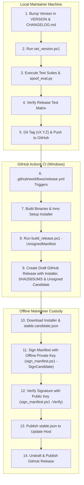

# Peek Official Release Guide

This document defines the formal, repeatable release procedure for Peek Face Authentication. It details every gate from pre-release version bumping to offline cryptographic signing and distribution.

---

## 1. Security Architecture & Threat Model

### The Offline Signing Invariant
To protect users from supply-chain compromises, Peek strictly adheres to the **Offline Signing Invariant**:

> [!IMPORTANT]
> The ECDSA P-256 update manifest signing private key (`peek_update_primary.key`) **MUST NEVER be stored on GitHub Actions, CI/CD runners, or committed to version control**.
> 
> Application code must **NEVER** generate keys at runtime. All trust originates from embedded public keys compiled directly into `PeekUpdate` (`SignatureVerifier.cs`).
>
> Continuous Integration runners only generate **unsigned candidate manifests** (`manifest-candidate.json` / `stable.candidate.json`). An authorized maintainer must sign the manifest locally on an isolated, secure machine using the offline private key.

### Cryptographic Key Generation & Rotation

Update manifests are verified using ECDSA P-256 (`secp256r1`) public keys embedded in `PeekUpdate\Services\SignatureVerifier.cs`. Peek embeds both a primary and secondary public key (`PrimaryPublicKeyBase64` and `SecondaryPublicKeyBase64`) to support seamless key rotation.

#### 1. Generating a Keypair Offline
Run the key generator on an offline, trusted workstation:
```powershell
powershell -ExecutionPolicy Bypass -File scripts\release\sign_manifest.ps1 `
    -GenKey `
    -OutKeyPath "C:\secure\keys\peek_update_primary.key" `
    -OutPublicKeyPath "C:\secure\keys\peek_update_primary.pub"
```
The script outputs:
- The private key file (`peek_update_primary.key` in CNG EccPrivateBlob format).
- The public key file (`peek_update_primary.pub` in CNG EccPublicBlob base64 format).
- The raw Base64 string for immediate embedding.

#### 2. Offline Private Key Custody
- **NEVER** commit private `.key` files to Git, GitHub Actions secrets, or CI environments.
- Store the private key on air-gapped encrypted hardware (e.g., FIPS-certified USB drive or hardware security module).
- Restrict file access permissions: only the release officer should have read permissions.

#### 3. Embedding the Public Key
Copy the Base64 public key output into [`app/PeekUpdate/Services/SignatureVerifier.cs`](../app/PeekUpdate/Services/SignatureVerifier.cs):
```csharp
public const string PrimaryPublicKeyBase64 = "<new_ecc_public_blob_base64>";
```
When rotating keys:
1. Promote the current `PrimaryPublicKeyBase64` to `SecondaryPublicKeyBase64`.
2. Generate a new keypair and assign the new public key to `PrimaryPublicKeyBase64`.
3. Release an update containing both keys. This ensures existing installations verify signatures from either key.
4. Unit tests (`PeekSetup.Tests`) enforce that release builds cannot use the development test keys.

### Release Pipeline Flow



---

## 2. Pre-Release Verification Checklist

Prior to tagging any release, the maintainer must complete all pre-release gates:

### Gate 1: Version Bumping
1. Choose the target Semantic Version (e.g. `0.2.0` or `0.2.0-beta.1`).
2. Update the `VERSION` file in the root directory:
   ```text
   0.2.0
   ```
3. Update `CHANGELOG.md` following [Keep a Changelog](https://keepachangelog.com/en/1.0.0/):
   - Move relevant items from `[Unreleased]` to a new section `## [0.2.0] - YYYY-MM-DD`.
   - Ensure `Added`, `Changed`, `Deprecated`, `Removed`, `Fixed`, and `Security` sections are accurate.
4. Execute version stamping script:
   ```powershell
   powershell -ExecutionPolicy Bypass -File scripts\release\set_version.ps1 -Version 0.2.0
   ```
   *Verifies version synchronization in `credential_provider/version.h`, `Directory.Build.props`, `engine/_version.py`, and `installer/version.iss`.*

### Gate 2: Local Automated Test Suite
Run the full test battery:
```powershell
# 1. .NET Unit Tests (169+ tests covering PeekSetup & PeekUpdate)
dotnet test app\PeekSetup.Tests\PeekSetup.Tests.csproj -c Release -p:UseSharedCompilation=false

# 2. Python Protocol & Biometric IPC Tests (170+ tests)
python -m pytest tests/

# 3. Credential Provider C++ Tests (33 autoselect & security tests)
credential_provider\build\Release\test_autoselect.exe
```
*All tests must pass with zero failures.*

### Gate 3: Biometric PAD & Spoof Evaluation Table
Update the empirical Presentation Attack Detection benchmark in [`docs/spoof_results.md`](spoof_results.md):
```powershell
python scripts/spoof_eval.py --manifest eval_data/manifest.csv --output-markdown docs/spoof_results.md
```
- Confirm the spoof evaluation table is current.
- Ensure False Rejection Rate (FRR) on genuine users meets target criteria ($\le 2.0\%$).
- Ensure Attack Success Rate (ASR) across print, screen, and replay attacks is strictly $0.0\%$.

### Gate 4: Release Test Matrix Verification
Review and check off all target environments specified in [`docs/RELEASE_TEST_MATRIX.md`](RELEASE_TEST_MATRIX.md):
- [ ] Clean Windows 10 (1809+ / 22H2) clean VM snapshot.
- [ ] Clean Windows 11 (22H2 / 23H2 / 24H2) clean VM snapshot.
- [ ] Post-Cumulative Update resilience check.
- [ ] Smart App Control (SAC) enforce mode verification.
- [ ] Multi-user workstation with Fast User Switching (`BUILTIN\Users`).

---

## 3. Creating the Release on GitHub

Once all pre-release gates pass:

1. Commit version bumps and documentation updates:
   ```powershell
   git add VERSION CHANGELOG.md docs/spoof_results.md
   git commit -m "chore(release): prepare v0.2.0"
   ```
2. Create an annotated Git tag matching `v*.*.*`:
   ```powershell
   git tag -a v0.2.0 -m "Release v0.2.0"
   ```
3. Push commit and tag to GitHub:
   ```powershell
   git push origin main
   git push origin v0.2.0
   ```

4. **GitHub Actions Automation**:
   - The `.github/workflows/release.yml` workflow triggers on the tag.
   - Compiles `PeekCredentialProvider.dll`, builds `PeekEngine.exe` (PyInstaller one-DIR), and compiles `PeekSetup.exe` and `PeekUpdate.exe`.
   - Executes Inno Setup 6 to generate `Peek-Setup-0.2.0-x64.exe`.
   - Runs `build_release.ps1 -UnsignedManifest`, generating `stable.candidate.json` and `SHA256SUMS`.
   - Extracts release notes from `CHANGELOG.md`.
   - Creates a **Draft GitHub Release** containing:
     - `Peek-Setup-0.2.0-x64.exe`
     - `SHA256SUMS`
     - `stable.candidate.json` (unsigned candidate)
     - `beta.candidate.json` (unsigned candidate)

---

## 4. Offline Manifest Signing by Maintainer

After the draft release is generated on GitHub:

1. **Download Release Assets**:
   Download the installer `Peek-Setup-0.2.0-x64.exe`, `SHA256SUMS`, and `stable.candidate.json` from the Draft Release.
2. **Verify Download Checksum**:
   ```powershell
   $expectedHash = (Get-Content SHA256SUMS | Select-String "Peek-Setup-0.2.0-x64.exe").ToString().Split(" ")[0]
   $actualHash = (Get-FileHash Peek-Setup-0.2.0-x64.exe -Algorithm SHA256).Hash.ToLowerInvariant()
   if ($expectedHash -ne $actualHash) { throw "Installer SHA-256 mismatch!" }
   ```
3. **Sign the Candidate Offline**:
   On the secure maintainer workstation holding the offline ECDSA P-256 private key:
   ```powershell
   powershell scripts\release\sign_manifest.ps1 `
       -SignCandidate `
       -ManifestPath stable.candidate.json `
       -PrivateKeyPath "C:\secure\keys\peek_update_primary.key" `
       -OutManifestPath stable.json
   ```
   *(If publishing to the beta channel, repeat for `beta.candidate.json`)*.
4. **Verify Signed Manifest**:
   ```powershell
   powershell scripts\release\sign_manifest.ps1 -Verify -ManifestPath stable.json
   ```
   *Expected output: `[OK] Manifest signature verified successfully for version 0.2.0 (stable).`*

---

## 5. Publishing and Announcing

1. **Publish to Update Host**:
   - Commit and push `stable.json` and `beta.json` to the update mirror repository (e.g. `https://rinu143.github.io/peek` or designated CDN).
2. **Verify Live Update Feed**:
   - Run a test check against the live feed:
     ```powershell
     PeekUpdate.exe --check --now
     ```
   - Confirm `PeekUpdate` detects version `0.2.0` with valid cryptographic signature.
3. **Publish GitHub Release**:
   - Navigate to GitHub repository -> **Releases**.
   - Edit the draft release for `v0.2.0`.
   - Upload the signed `stable.json` and `beta.json` as release assets.
   - Click **Publish release**.
4. **Community Notification**:
   - Post release announcement in GitHub Discussions / project communication channels.
